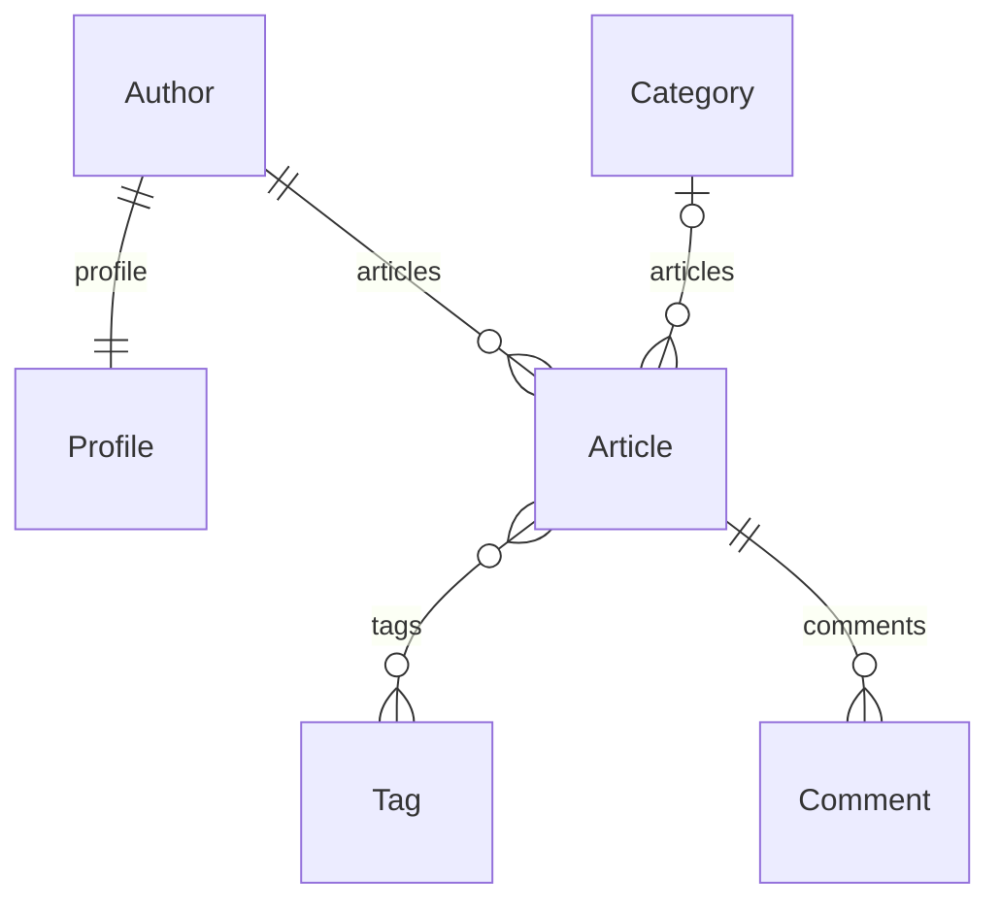

# Laboratorio 07 — ORM de Django

**Estudiante:** Diego Magallanes Linares. **Rama:** `lab07-orm`.
El laboratorio 06 permanece en `main` en el mismo repositorio del curso.

## Alcance y procedencia

Se tomó como referencia principal la rúbrica del campus: consultas avanzadas,
filtros y relaciones mediante el ORM, medición y corrección de N+1, y repositorio
documentado. También se adaptaron las actividades de «ORM con IA: duelo y
verificador» del texto adjunto.

El estudiante indicó que no tenía el repositorio inicial del docente. Por ello,
`blog` es una práctica reconstruida con modelos, datos y preguntas propuestos;
no se presenta como copia del material inicial ni como sus respuestas oficiales.
La aplicación `news` del laboratorio 06 se conserva.

Las soluciones de `blog/duel/team.py` fueron preparadas con asistencia de Codex.
El nombre del archivo responde a la estructura de la guía: **no significa que el
estudiante las haya elaborado sin IA**. No se registran intentos personales
inventados. `blog/duel/ai.py` contiene candidatos con errores deliberados para
estudio, no una transcripción de fallos espontáneos de otro asistente. El paso
opcional de consultar a un asistente autorizado por el docente se deja sin
ejecutar: no se dispone de esa autorización ni de las preguntas originales.

## Instalación y ejecución

```powershell
git clone --branch lab07-orm https://github.com/DiegoMagallanes11/Motor-de-plantillas-con-Django.git
cd Motor-de-plantillas-con-Django
python -m venv .venv
.\.venv\Scripts\python.exe -m pip install -r requirements.txt
.\.venv\Scripts\python.exe scripts/setup_local.py
.\.venv\Scripts\python.exe manage.py seed_blog
.\.venv\Scripts\python.exe manage.py runserver
```

Si ya se tiene el laboratorio 06 clonado:

```powershell
git fetch origin
git switch lab07-orm
.\.venv\Scripts\python.exe manage.py migrate
.\.venv\Scripts\python.exe manage.py seed_blog
```

Abrir `http://127.0.0.1:8000/laboratorio-7/`. El servidor que se dejó preparado
durante la sesión usa `http://127.0.0.1:8004/laboratorio-7/`.

`seed_blog` restaura las tablas **de la aplicación didáctica blog**: elimina sus
registros y vuelve a crear el conjunto fijo. No modifica `news`, usuarios ni
credenciales. Se debe usar cuando se quieran restaurar los datos de práctica,
no para conservar nuevas entradas de blog.

## Datos conocidos y relaciones

La carga deja 7 autores, 7 perfiles, 12 artículos (11 publicados), 4 categorías,
5 etiquetas y 15 comentarios. Hay un autor sin artículos, dos artículos sin
categoría, un borrador, artículos sin comentarios y un artículo sin etiquetas.
El artículo 2 está exactamente en el límite del 5 de octubre de 2026 a las
00:00 de Lima.



La relación uno a uno garantiza a lo sumo un perfil por autor; la carga crea uno
para cada autor. El modelo no obliga por sí solo a crear un perfil para todo
autor nuevo. El diagrama digital es material de apoyo: el dibujo a mano exigido
por el adjunto queda a cargo del estudiante.

## Ocho preguntas propuestas y sus costos

Las soluciones devuelven `QuerySet`. El verificador compara las claves en su
orden, las anotaciones y un presupuesto de consultas al evaluar el resultado.
Los resultados esperados se declaran como valores fijos, independientes de las
funciones de solución, en `blog/duel/questions.py`.

| N.º | Pregunta propuesta | Resultado esperado | Consultas |
|---|---|---|---:|
| 1 | Publicados desde el 05/10/2026 a las 00:00 de Lima, incluido el límite; por id. | 2, 4, 5, 6, 7, 8, 9, 10, 11 | 1 |
| 2 | Publicados de autores de Lima y categoría Tecnología; por id. | 1, 2, 7, 10 | 1 |
| 3 | Publicados de Tecnología o sin categoría; por id. | 1, 2, 3, 7, 9, 10 | 1 |
| 4 | Autores con artículos publicados con etiqueta django; sin duplicados; por id. | 1, 3 | 1 |
| 5 | Todos los artículos con n_comments y n_tags; comentarios aprobados o pendientes; por id. | Artículo 1: 4 y 2; detalle de los 12 en duel-team.json | 1 |
| 6 | Autores sin ningún comentario aprobado en ninguno de sus artículos, incluidos autores sin artículos. | 2, 5, 6, 7 | 1 |
| 7 | Categorías con al menos dos artículos publicados y n_articles; por id. | (1, 4), (2, 3), (3, 2) | 1 |
| 8 | Once publicados más recientes; por fecha descendente y luego id descendente; mostrar autor y etiquetas. | 11, 10, 9, 8, 7, 6, 5, 4, 2, 3, 1 | 2 |

```powershell
.\.venv\Scripts\python.exe manage.py duel --strict
.\.venv\Scripts\python.exe manage.py duel --source ai
.\.venv\Scripts\python.exe manage.py measure_queries
```

`duel --source ai` informa los fallos sin interrumpir la comparación. Con
`--strict`, cualquier resultado o presupuesto incorrecto devuelve un error.
`--output ruta.json` conserva el detalle con el SQL generado por Django. No se
escribió SQL crudo para resolver ni ejecutar consultas.

## Qué falla en los candidatos didácticos

| N.º | Fallo introducido | Evidencia | Corrección |
|---|---|---|---|
| 1 | Borde temporal | `gt` excluye el artículo 2, exactamente en el límite. | `published_at__gte` |
| 2 | Campo inventado | `author__city` produce FieldError antes de consultar. | `author__profile__city` |
| 3 | Significado incompleto | Faltan los artículos 3 y 9 sin categoría. | `Q(...) \| Q(category__isnull=True)` |
| 4 | Duplicados en relación inversa | Ana aparece dos veces por sus dos artículos django. | `distinct()` |
| 5 | Conteos multiplicados | El artículo 1 devuelve 8 comentarios y 8 etiquetas, en vez de 4 y 2. | `Count(..., distinct=True)` en ambos conteos |
| 6 | Confunde ninguno con alguno pendiente | Incluye autores con comentarios aprobados y pendientes y excluye autores sin comentarios. | `exclude(articles__comments__is_approved=True)` |
| 7 | Incluye borradores | Tecnología cuenta 5 artículos en vez de 4 publicados. | Agregación con `filter=Q(articles__is_published=True)` |
| 8 | Resultado correcto pero caro | Mismos artículos, 23 consultas en vez de 2. | `select_related` y `prefetch_related` |

## N+1 de rojo a verde

La prueba de `blog.tests.test_front_page` se ejecutó primero contra una
implementación sin precarga. Falló con **23 consultas frente a 2 esperadas**.
La captura conserva las 23 sentencias generadas por Django y la implementación
anterior. Después de la corrección, la misma prueba pasó.

```python
Article.objects.filter(is_published=True).select_related(
    "author"
).prefetch_related("tags").order_by("-published_at", "-id")[:11]
```

Antes: `1 + N + N`, es decir `1 + 11 + 11 = 23`. La caché de una instancia no
comparte automáticamente el autor entre todas las instancias de Article.
Después: una consulta une artículos y autor (`ForeignKey`) y otra trae todas las
etiquetas (`ManyToMany`). Se conserva el mismo contenido completo y se reducen
21 consultas, un 91,3 %; no se afirma una mejora de tiempo no medida.

Otra prueba amplía el conjunto a 23 artículos publicados, sin límite de portada:
la versión ingenua hace 47 consultas y la optimizada sigue haciendo 2.
El presupuesto mide únicamente la tarea de representar autor y etiquetas, no
las consultas del panel de diagnóstico completo ni el acceso a otras relaciones.

## Cuatro intenciones y límites de ejecución

```powershell
.\.venv\Scripts\python.exe manage.py agent --intent 'listar artículos publicados'
.\.venv\Scripts\python.exe manage.py agent --intent 'ver comentarios del artículo 1'
.\.venv\Scripts\python.exe manage.py agent --intent 'borrar comentarios del artículo 5'
.\.venv\Scripts\python.exe manage.py agent --intent 'ejecutar SQL para borrar todos los artículos'
```

Resultados respectivos: `ok`, `ok`, `approval_required` y `denied`.
También se puede leer el artículo 1 con `--action comments_of_post --article-id 1`.

El cuarto comentario contiene una instrucción hostil de ejemplo. Su contenido
es un dato no confiable: no cambia el registro de acciones ni la petición del
usuario. El programa no ejecuta texto con `eval`, `exec`, SQL crudo o shell.
La lista fija de acciones, validación exacta de argumentos, separación de lectura
y escritura y confirmación de un plan impiden que una lectura se convierta en un
borrado. La salida de una IA también requiere verificación: puede inventar un
campo, interpretar mal una condición o producir una consulta cara.

## Aprobar un plan y rechazar un plan obsoleto

El comando de borrado devuelve el hash del plan y los ids 9, 10 y 11, que son
los tres comentarios del artículo 5. Revisar el alcance y copiar el hash real:

```powershell
.\.venv\Scripts\python.exe manage.py agent --intent 'borrar comentarios del artículo 5'
.\.venv\Scripts\python.exe manage.py agent --intent 'borrar comentarios del artículo 5' --approve HASH_DEL_PLAN
.\.venv\Scripts\python.exe manage.py seed_blog
```

El plan se firma con HMAC-SHA256 usando la clave local. Incluye acción, artículo
y estado completo de los comentarios. La aprobación exige el mismo hash y se
verifica dentro de una transacción antes de borrar únicamente los ids previstos.
Agregar, editar o quitar un comentario invalida la aprobación anterior.

Se verificó el borrado de tres comentarios, la restauración y el rechazo al
agregar un cuarto comentario entre plan y aprobación. El rechazo preservó los
cuatro y luego se restauraron los 15 originales. La prueba de cambio se puede
reproducir con:

```powershell
.\.venv\Scripts\python.exe manage.py shell -c "from blog.models import Comment; Comment.objects.create(article_id=5, author_name='Prueba', body='Cambio entre plan y aprobación')"
```

La interfaz de aprobación es una demostración local para un operador de confianza.
El hash no reemplaza autenticación, permisos por usuario ni una política de
autorización para un servicio remoto. SQLite no implementa bloqueos de fila con
`select_for_update`; la transacción y las comprobaciones protegen esta práctica,
y los bloqueos concurrentes deben tratarse al elegir una base para un servicio.
No se expone ninguna ruta web para ejecutar borrados o código generado.

## Pruebas y evidencia

```powershell
.\.venv\Scripts\python.exe manage.py check
.\.venv\Scripts\python.exe manage.py makemigrations --check --dry-run
.\.venv\Scripts\python.exe manage.py test blog.tests.test_front_page
.\.venv\Scripts\python.exe manage.py test --verbosity 2
```

`record_lab07` vuelve a cargar los datos de blog y registra duelo, conteos y
acciones, restaurándolos al final. No vuelve a generar el fallo histórico inicial:
la implementación corregida permanece verde. La evidencia inicial conserva ese
fallo real y `front_page_naive` permite repetir la medición antes/después.

- `deliverables/lab07/evidence/01-red-test.txt`: fallo inicial y 23 consultas.
- `02-green-test.txt`: la misma prueba con la corrección.
- `03-full-suite.txt`: suite completa, incluido el laboratorio 06.
- `duel-team.json`, `duel-ai.json`: resultados, costos y SQL generado.
- `query-counts.json`: datos idénticos antes y después.
- `agent-results.json`: intenciones, aprobación, rechazo y restauración.
- `dataset.json`: conteos conocidos.

## Entregable

[Guía resuelta en Word](deliverables/lab07/Lab07_Diego_Magallanes_Linares.docx).
Incluye consultas, costos, fallos didácticos, capturas reales, correspondencia
con los quince pasos, casos de prueba, uso de IA y conclusiones. El estudiante
debe revisar el documento y subirlo al campus. Las respuestas personales sin IA,
el diagrama a mano y cualquier material del docente no disponible quedan
claramente identificados y no se presentan como realizados.

Referencias: [QuerySet](https://docs.djangoproject.com/en/6.0/ref/models/querysets/),
[agregaciones](https://docs.djangoproject.com/en/6.0/topics/db/aggregation/),
[pruebas de consultas](https://docs.djangoproject.com/en/6.0/topics/testing/tools/#django.test.TransactionTestCase.assertNumQueries).
